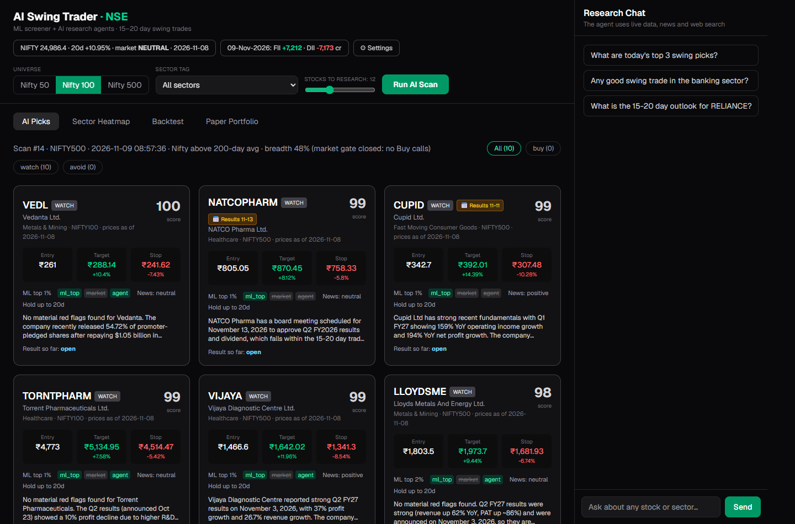
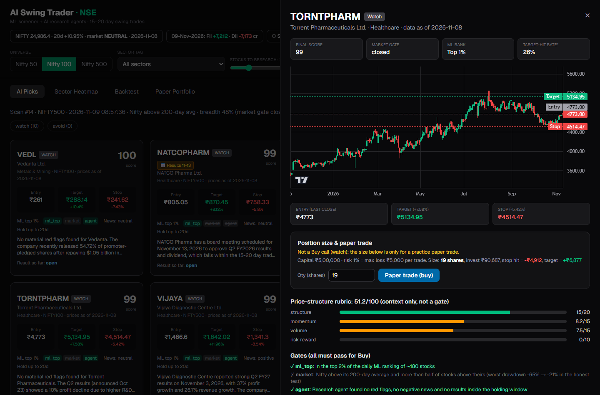
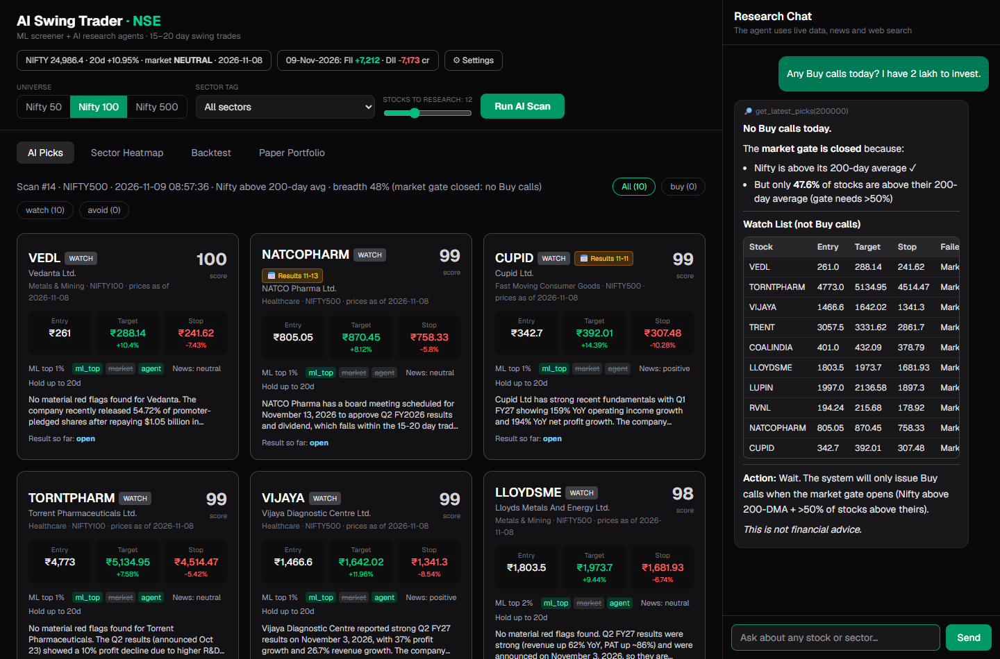
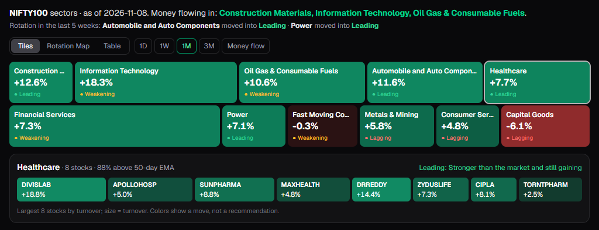
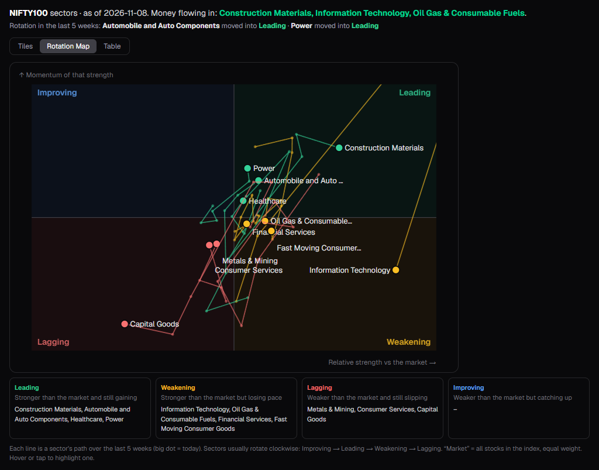
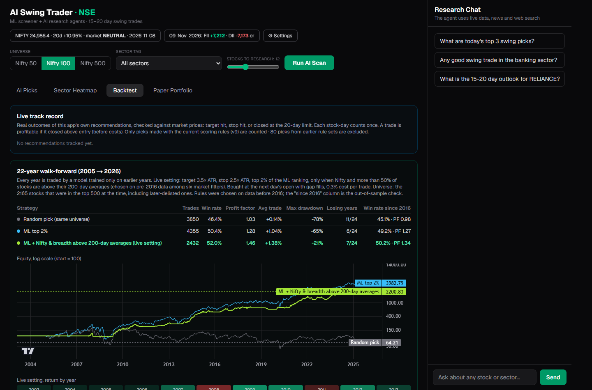
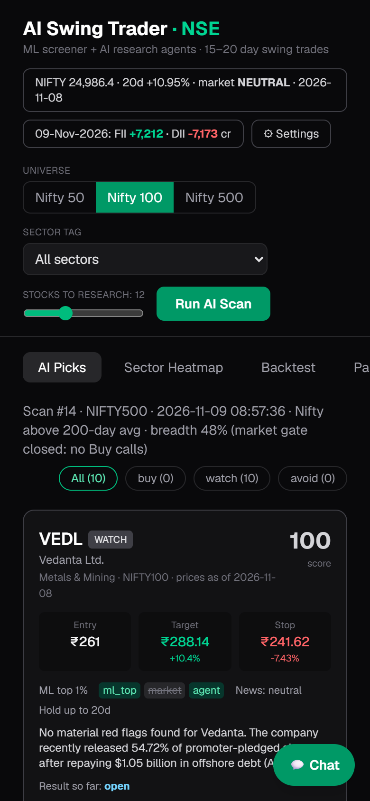
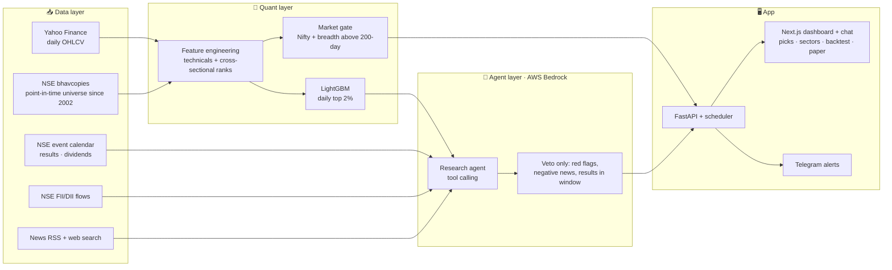

<div align="center">

# 📈 AI Swing Trader · NSE

**An end-to-end AI system that finds 15–20 day swing trades in Indian stocks (Nifty 50 / 100 / 500),
researches each one with LLM agents, and tracks every call against real market data.**


[](https://github.com/musaddiq-vd/stock-recommendation-system/actions/workflows/ci.yml)


[Screenshots](#-screenshots) · [Features](#-features) · [How it works](#-how-it-works) · [Results](#-backtest-results) · [Quick start](#-quick-start) · [Configuration](#%EF%B8%8F-configuration) · [API](#-api-reference) · [Security](#-security-and-privacy) · [Limitations](#%EF%B8%8F-limitations)

<br/>



</div>

> [!WARNING]
> This project is for **education and research only**. It is not investment advice, and nothing here is a
> recommendation to buy or sell any security. Markets carry risk; past backtest results do not guarantee future returns.

---

## 📸 Screenshots

| | |
|---|---|
| **Stock detail:** chart with entry / target / stop, risk-based size, rubric and the three Buy checks | **Research chat:** reads the latest scan, says when there is no Buy call and why |
|  |  |
| **Sector heatmap:** tiles sized by turnover; click a sector to see its stocks | **Rotation map:** which sectors are leading, weakening, lagging or improving vs the market |
|  |  |
| **Backtest:** live track record and the 22-year survivorship-free walk-forward | **Mobile:** the same dashboard on a phone, chat behind a button |
|  |  |

<sub>Screenshots from a local run on 9 Nov 2026, when the market gate was closed (no Buy calls that day). Market data only; not advice.</sub>

---

## ✨ Features

| | Feature | What it does |
|---|---|---|
| 🧮 | **ML screener** | A LightGBM model ranks ~480 liquid NSE stocks every day by the probability that a long swing trade hits its target before its stop within 20 sessions. |
| 🌡️ | **Market gate** | Buy calls only when Nifty and more than half of the market's stocks are above their 200-day averages; this cut the worst drawdown from −65% to −21% in the honest backtest. |
| 🤖 | **Research agent** | For the top candidates, an LLM agent (AWS Bedrock) reads news, filings, fundamentals and official NSE event dates, and can veto a pick for red flags, negative news or results inside the holding window. |
| 🟢 | **One honest Buy tier** | A stock is a green **Buy** only when all three checks pass: top 2% of the daily ML ranking, market gate open, research agent clear. Everything else is **Watch** or **Avoid**, never a buy. |
| 🧭 | **Market context** | Nifty regime (bullish / neutral / bearish), FII/DII net flows and a sector **money-flow heatmap**. |
| 📐 | **Position sizing** | Risk-based sizing for Buy calls: lose at most your risk % of capital if the stop hits, never invest more than your capital. Shows shares, capital used, max loss and target profit. |
| 📝 | **Paper trading** | Open virtual trades from any pick. They auto-close at target, stop or the 20-day timeout, with live P&L. |
| 🔔 | **Telegram alerts** | New Buy calls, target/stop hits, paper-trade exits, a weekly summary, and warnings when a scan fails or data goes stale. |
| 🔬 | **22-year research** | Walk-forward test from 2004 to 2026 on 30 years of data: 20 target/stop settings, regime and rubric filters, a random baseline and an anonymised LLM test. |
| 📈 | **Live track record** | Real outcomes of the app's own past picks (target, stop or 20-day exit), per tier. |
| 📊 | **Backtest dashboard** | Out-of-sample equity curve vs Nifty, drawdown chart, monthly returns and a feature-set comparison. |
| 💬 | **Research chat** | Ask about any stock or sector. The chat uses the same live tools and the latest scan, only calls Buy-tier picks a buy, sizes positions by your risk setting and never invents price levels. |
| ⏰ | **Automation** | Daily scan after market close, intraday target/stop checks every 15 minutes, monthly model retraining. |

---

## 🧠 How it works



### 1. The trade definition
Every signal is a long **triple-barrier** trade sized by volatility (ATR), modelled the way it can really be traded:

| | Long |
|---|---|
| Signal | After the close |
| Entry | **Next day's open** |
| Target | Entry **+ 3.5 × ATR** |
| Stop-loss | Entry **− 2.5 × ATR** |
| Gaps | A gap through a level fills at that day's open (a gap below the stop loses more than the stop) |
| Time limit | 20 trading days |
| Costs | 0.2% brokerage and taxes + 0.1% slippage per round trip |

The ML label is *"bought at the next open, did the target hit before the stop within 20 days?"*. When both levels are
touched in one bar, the stop is assumed to hit first. Trades last ~13 sessions on average; a third run the full 20 days.

### 2. ML screener
- **Features:** RSI, MACD, ADX, ATR %, distance from EMA 20/50/200 and 52-week high/low, volume surge,
  Bollinger position, 5/20/60/120-day returns, 12-month momentum (skipping the last month), volatility
  contraction, days since the 1-year high, close location in the day's range, 60-day trend smoothness, relative
  strength vs Nifty and vs the stock's own sector, plus **cross-sectional ranks** (momentum, trend smoothness,
  liquidity) and **sector momentum** across the whole universe each day.
- **Training:** ~2.3 million rows from the point-in-time universe (every stock as it was each month since 2003,
  including later-delisted ones), time-based split with an embargo so the held-out year never overlaps training labels.
  Training on today's survivors instead made the top picks much worse (profit factor 1.13 vs 1.36).
- **Tried and dropped** because they did not improve the honest backtest: delivery %, futures OI and options PCR as
  features, short setups, a LightGBM + logistic-regression ensemble, isotonic probability calibration (it did not hold
  up in later years), a rule-based price-structure rubric as a gate (still shown on each pick for context), a cap of
  2 Buys per sector, breakeven / trailing stops (they cut the win rate to 30–45% without a consistent gain), and a
  LightGBM ranking model or return regressor instead of the classifier (worse profit factor and twice the drawdown).
- **Added after testing** (`python -m app.research.feature_lab`): the 11 newer features above raised the live rule's
  profit factor from 1.50 to 1.66 on 2005–2015 data, where they were chosen, and from 1.30 to 1.34 on 2016–2026,
  with the worst drawdown down from −23% to −20%. Picks scored with them carry scoring version 9.

### 3. Market gate
Buy calls are only made when **Nifty is above its 200-day average and more than 50% of liquid Nifty 500 stocks are above
their own 200-day averages**. Six market filters were compared; this one was the best on 2005–2015 data (profit factor
1.53) and it held up on 2016–2026 data it was not chosen on. With the current model it scores profit factor 1.34 and a
worst drawdown of −20% on 2016–2026.

### 4. Research agent (veto only)
200 past signals were shown to the LLM with the name, sector and dates hidden and prices rebased to 100. Its chart
reading did **not** separate winners from losers (AUC 0.48), so the agent never adds to the score. Its job is the part a
price model cannot see: news, filings and event dates. It holds a pick back when it finds a confirmed serious red flag
(fraud, trading ban, default, large asset seizure; small procedural fines do not count), clearly negative news, or
results inside the holding window. Official NSE event dates always override its own guess, and it runs at temperature 0
so the same facts give the same verdict.

### 5. Decision rule
| Call | Rule | Backed by (22-year test, delisted stocks included) |
|---|---|---|
| 🟢 **Buy** | top 2% of the daily ML ranking, market gate open, agent clear | 52.0% profitable, profit factor 1.46, worst drawdown −21% (2016+: 50.2%, 1.34, −20%) |
| ⚪ **Watch** | anything that fails a gate | – |
| 🔴 **Avoid** | confirmed red flag | – |

Every Buy card shows these numbers, so the label never promises more than history delivered. The edge is real but modest:
expect roughly half of the trades to lose, with winners slightly larger than losers on average.

---

## 📊 Backtest results

### Survivorship-free 22-year walk-forward (2005 → 2026)
Testing only today's Nifty 500 hides every company that later collapsed or was delisted. This test rebuilds the
universe month by month from NSE's daily bhavcopies (**2,165 stocks** that were in the top 500 by traded value at the time,
including later-delisted ones), adjusts prices for splits and bonuses, and retrains the model every year on earlier data
only. Entries are at the next day's open with gap fills, 0.3% cost per trade, 10-slot portfolio. Rules were chosen on data
before 2016; 2016–2026 is the out-of-sample check.

| Strategy | Trades | Profitable | Profit factor | Worst drawdown | 2016+ profit factor |
|---|---:|---:|---:|---:|---:|
| Random pick, same universe | 3,850 | 46.4% | 1.03 | −78% | 1.10 |
| ML top 2% | 4,355 | 50.4% | 1.28 | −65% | 1.27 |
| ML top 2% + Nifty > 200-day average | 2,996 | 50.9% | 1.31 | −37% | 1.20 |
| ML top 2% + 50-day breadth > 50% | 2,994 | 52.0% | 1.38 | −35% | 1.28 |
| **ML top 2% + Nifty & 200-day breadth (live rule)** | **2,432** | **52.0%** | **1.46** | **−21%** | **1.34** |

With the scoring version 8 features (before the 11 newer ones) the live rule scored 51.6%, profit factor 1.38 and
−23% on the same test.

How much the earlier, rosier numbers were inflated (version 8 features):

| Same ML strategy | Profit factor |
|---|---:|
| Today's Nifty 500, close entry, 0.2% cost (old test) | 1.52 |
| Today's Nifty 500, next-open entry, gaps, 0.3% cost | 1.48 |
| **Point-in-time universe incl. delisted, next-open, gaps, 0.3% cost** | **1.20** |

Other findings:
- **Win rate vs. profit:** smaller targets push win rate to 62–76%, but the profit factor drops and trades last only 6–9 days.
- **Short setups** lost money in all 20 target/stop settings, so the app is long-only.
- **Ensemble** (LightGBM + logistic regression): no improvement out of sample. **Calibration** fitted before 2016 was
  further off after 2016 (top decile: 29% predicted vs 34% actual), so the app shows observed hit rates instead.

Reproduce with:
```bash
python -m app.research.pit download     # NSE daily bhavcopies since 2002 (~6,500 files, resumable)
python -m app.research.pit build        # split/bonus-adjusted prices + monthly point-in-time top-500 universe
python -m app.research.v2 build pit     # features and realistic outcomes
python -m app.research.v2 walk pit      # yearly walk-forward (LightGBM and logistic regression)
python -m app.research.v2 report pit    # every variant above, plus calibration and AUC
python -m app.research.v2 export pit    # numbers shown in the dashboard's Backtest tab
python -m app.research.exits pit        # sector caps, breakeven and trailing stops
python -m app.research.training_data      # train on survivors vs point-in-time: which ranks better?
python -m app.research.feature_lab extra   # candidate features (then: feature_lab run)
```
The same pipeline runs on today's Nifty 500 with `yahoo` instead of `pit` (after `python -m app.research.history`).

### Latest model, last 12 months
The live model is trained on the point-in-time universe (a model trained on today's survivors scored profit factor 1.13
on the honest 2010–2026 walk-forward, against 1.36 when trained point-in-time). Its held-out year, **Oct 2025 → Oct 2026**,
on the point-in-time universe, ML top 2% only (no market or agent gate), next-open entries, gaps, 0.3% cost:

| Long model | Value |
|---|---:|
| Target-hit rate, random stock | 22.4% |
| Target-hit rate, top ML signals | 23.8–26.1% |
| Portfolio return (10 slots, top 2% signals) | +1.3% |
| Nifty 50, same period | −10.6% |
| Profitable trades after costs | 44.4% |
| Max drawdown | −15.7% |
| Holdout AUC | 0.51 |

A weak year for the model on its own: it stayed roughly flat (+1.3%) while Nifty fell 10.6%. The market gate, which keeps the
app out of most such periods, is not applied here; one year is too short to judge, so the 22-year test above is the
reference.

**Win rate** in this README means trades that closed in profit after costs (at the target, or above entry at the 20-day exit).
**Target-hit rate** counts only trades that reached the full target before the stop.


---

## 🖥️ Dashboard

| Tab | What you see |
|---|---|
| **AI Picks** | Scanned stocks as cards (filter All / Buy / Watch / Avoid) with entry / target / stop, the three checks and official event badges; Buy cards also show the 22-year stats and position size. A line on top says whether the market gate is open. Click a card for the candlestick chart, rubric breakdown, gates, the agent's news findings, fundamentals, sources and the full research trail. |
| **Sector Heatmap** | Money flow (20D / 5D), 1D–3M returns, relative strength, breadth, turnover and delivery surge per sector. |
| **Backtest** | Live track record of past picks, the 22-year walk-forward (equity, yearly returns, per-tier stats) and the latest model's 12-month test. |
| **Paper Portfolio** | Virtual equity, realized / unrealized P&L, win rate and every open or closed trade. |

The research chat sits on the right (a floating button on mobile). Settings hold capital, risk % and Telegram.

---

## 🚀 Quick start

### Prerequisites
- Python **3.11+**, Node.js **20+**
- An AWS account with **Bedrock** access to a tool-calling model, and credentials configured locally (`aws configure`)

### 1. Backend
```bash
cd backend
python -m venv .venv
# Windows: .venv\Scripts\activate    macOS/Linux: source .venv/bin/activate
pip install -r requirements-dev.txt  # runtime + test/lint tools
cp .env.example .env                 # then edit if needed

python -m app.data.nse              # one-time: ~4 months of NSE delivery data for the heatmap (~3 min)
python -m app.model.train            # trains the model (uses point-in-time data if the research pipeline has run)
uvicorn app.main:app --port 8000
```

### 2. Frontend
```bash
cd frontend
npm install
npm run dev                          # http://localhost:3000
```

### 3. First scan
Open the dashboard, choose **Nifty 50 / 100 / 500**, an optional sector and how many stocks to research, then press **Run AI Scan**.
Agent progress streams live; a 20-stock scan takes about 5–8 minutes.

---

## ⚙️ Configuration

All settings live in `backend/.env` (see `.env.example`). AWS credentials come from the standard AWS config or
environment variables, never from this repo.

| Variable | Default | Description |
|---|---|---|
| `APP_PASSWORD` | *(empty)* | Dashboard password. **Required in production**; empty disables login (local development only) |
| `APP_SECRET` | *(random)* | Signs login tokens. Set a long random value so sessions survive restarts |
| `TOKEN_TTL_HOURS` | `168` | How long a login stays valid |
| `ALLOWED_ORIGINS` | `http://localhost:3000` | Comma-separated dashboard URLs allowed to call the API (CORS) |
| `RUN_SCHEDULER` | `1` | Run the scheduled jobs in this API process; keep exactly one such process |
| `STORAGE_DIR` | `backend/storage` | Where prices, models and the SQLite database live |
| `LOG_LEVEL` | `INFO` | Python logging level |
| `AWS_REGION` | `us-east-1` | Bedrock region |
| `BEDROCK_MODEL_ID` | `moonshotai.kimi-k2.5` | Any Bedrock model that supports the Converse API with tool use |
| `HOLD_MIN_DAYS` / `HOLD_MAX_DAYS` | `15` / `20` | Swing holding window |
| `TARGET_ATR` / `STOP_ATR` | `3.5` / `2.5` | Barrier distances in ATR multiples |
| `ML_TOP_PCT` | `98` | Minimum ML percentile for a Buy (top 2%) |
| `BREADTH_MIN` | `0.5` | Minimum share of stocks above their 200-day average (Nifty must also be above its own) |
| `AGENT_TOP_N` | `15` | Default number of stocks sent to the agents |

In-app **Settings** (stored in the local database): capital, risk per trade %, Telegram bot token and chat ID, alerts on/off.

### Telegram alerts
1. Open **@BotFather** in Telegram → `/newbot` → copy the bot token.
2. Send `/start` to your new bot.
3. Paste the token in **Settings** and save (the chat ID is detected automatically), then press **Send test alert**.

> WhatsApp needs a paid Business API, so alerts use Telegram's free Bot API.

---

## ⏰ Automation

| Job | When (IST) | What it does |
|---|---|---|
| Daily scan | Mon–Fri 18:30 | Refresh NSE data and FII/DII, update outcomes and paper trades, run a Nifty 500 scan with research; Telegram alert if data is stale or the scan fails |
| Intraday check | Mon–Fri 09:00–15:45, every 15 min | Check paper trades and open Buy picks against live prices; send target/stop alerts |
| Weekly summary | Saturday 09:00 | Telegram report: market gate, latest Buy calls, live track record, paper P&L |
| Retrain | 1st Saturday of each month, 10:00 | Top up NSE bhavcopies, rebuild the point-in-time dataset, retrain the model |

The backend must stay running for these jobs (see [Deployment](#-deployment)).

---

## 🔌 API reference

| Method | Endpoint | Description |
|---|---|---|
| `GET` | `/api/health` | Health check (public) |
| `GET` `POST` | `/api/auth/status` · `/api/auth/login` | Whether login is required; exchange the password for a token |
| `GET` | `/api/universe` | Stocks and sectors in Nifty 50/100/500 |
| `POST` | `/api/scan` | Start a scan: `{universe, sector, top_n}` (409 while another scan runs) |
| `GET` | `/api/scans` · `/api/scans/{id}` · `/api/scans/latest` | Scan history, status, live progress log and picks |
| `GET` | `/api/stock/{symbol}` | Candles, technicals and fundamentals |
| `GET` | `/api/market` · `/api/flows` | Nifty regime and FII/DII flows |
| `GET` | `/api/sectors?index=NIFTY500` | Sector heatmap data |
| `GET` | `/api/backtest` · `/api/research` | Latest model's 12-month test and the 22-year walk-forward results |
| `GET` | `/api/model` | Model report |
| `GET` `POST` `DELETE` | `/api/paper` · `/api/paper/{id}/close` · `/api/paper/{id}` | Paper trading |
| `GET` `PUT` | `/api/settings` | Capital, risk, alerts (bot token is never returned) |
| `POST` | `/api/alerts/test` | Send a Telegram test message |
| `POST` | `/api/chat` | Research chat (server-sent events) |
| `GET` | `/api/performance` | Live track record of past recommendations by tier, plus the agent veto check |

Every endpoint except `/api/health` and `/api/auth/*` needs the login token when `APP_PASSWORD` is set.

Interactive docs are available at `http://localhost:8000/docs`.

---

## 🗂️ Project structure

```
backend/
  app/
    main.py              FastAPI routes, login middleware, scheduler jobs
    auth.py              Password login, signed tokens, rate limit
    config.py            Environment settings
    universe.py          Nifty 50/100/500 lists and sector tags
    features.py          Indicators, NSE features, triple-barrier labels
    sectors.py           Sector heatmap metrics
    paper.py             Paper trading engine
    alerts.py            Telegram alerts
    chat.py              Research chat agent
    db.py                SQLite storage
    data/
      prices.py          Yahoo prices with NSE bhavcopy fallback
      nse.py             NSE archives: official OHLC, delivery, FII/DII
      events.py          NSE corporate event calendar
      live.py            Intraday quotes
    model/train.py       Training, feature-set comparison, portfolio backtest
    agents/
      llm.py             Bedrock Converse tool-calling loop
      tools.py           Agent tools (technicals, fundamentals, events, news, web)
      research_agent.py  Veto-only research agent (news, filings, event dates)
      orchestrator.py    Scan pipeline, checks and tiers, outcome tracking
    research/            22-year research pipeline (not used at runtime)
      pit.py             NSE bhavcopies -> split-adjusted prices + point-in-time universe
      v2.py              Features, realistic outcomes, walk-forward, reports
      experiment.py      Portfolio simulator
      exits.py           Sector caps, breakeven and trailing-stop tests
      training_data.py   Survivor vs point-in-time training comparison
      llm_backtest.py    Anonymised LLM chart-reading test
  tests/                 API, chat, labels, look-ahead and paper-trading tests
frontend/
  app/page.tsx           Dashboard
  components/            Pick cards, stock drawer, heatmap, backtest, paper, chat, settings
  lib/                   API client and position sizing
docker-compose.yml       API + dashboard for a server
docker-compose.local.yml Overrides to run on your own computer
.github/workflows/ci.yml Lint, tests, type check and Docker builds
docs/screenshots/        Images used in this README
```

---

## 🧾 Data sources

| Source | Used for |
|---|---|
| Yahoo Finance (`yfinance`) | Daily and intraday prices, fundamentals |
| NSE archives | Index constituents, equity bhavcopy (OHLC fallback, delivery %), index closes |
| NSE APIs | Corporate event calendar, FII/DII cash flows |
| Google News RSS, DuckDuckGo | News and web research for the agents |
| AWS Bedrock | LLM for research agents and chat |

Yahoo data is ~15 minutes delayed intraday. When Yahoo misses the latest daily bar, it is filled from the official NSE bhavcopy.

---

## ☁️ Deployment

### Docker (recommended)
```bash
cp backend/.env.example backend/.env
# set APP_PASSWORD, APP_SECRET and AWS_ACCESS_KEY_ID / AWS_SECRET_ACCESS_KEY (or use an instance role)
docker compose up -d --build
```
- `api` on port 8000: FastAPI + scheduler, data in the `swing-data` volume, health check on `/api/health`.
- `web` on port 3000: the Next.js dashboard as a standalone Node server.
- For a public domain, set `PUBLIC_API_URL` (baked into the dashboard at build time) and `PUBLIC_WEB_URL`
  (allowed CORS origin) before `docker compose build`, and put both behind HTTPS (Caddy, Nginx or Cloudflare).
- After the first start, train the models once inside the container:
  `docker compose exec api python -m app.model.train`

### Run on your own computer
```bash
docker compose -f docker-compose.yml -f docker-compose.local.yml up -d --build
```
Uses your existing `backend/storage` data and `~/.aws` profile (read-only) and keeps the scheduler on. Docker Desktop must
be running (enable "Start Docker Desktop when you sign in") for the daily scan and alerts. If Docker Hub pulls fail, put
`PYTHON_IMAGE=public.ecr.aws/docker/library/python:3.11-slim` and `NODE_IMAGE=public.ecr.aws/docker/library/node:22-alpine`
in a root `.env` file to build from AWS's public mirror. This route also avoids Windows Smart App Control blocking
Python's native libraries.

### Production checklist
- [x] Password login with signed, expiring tokens and a rate limit on failed attempts
- [x] CORS limited to your dashboard URL; errors never return stack traces
- [x] Input validation on every endpoint (symbols, scans, chat, settings, paper trades)
- [x] One scan at a time; scans interrupted by a restart are closed automatically
- [x] Non-root containers, health checks, pinned Python dependencies, CI on every push
- [ ] Serve over HTTPS and keep `APP_PASSWORD` / `APP_SECRET` / AWS keys only in the server's `.env`
- [ ] Back up the `swing-data` volume (SQLite database, models and paper trades)

### Hosting options
The backend needs to run continuously for scans, alerts and retraining. Free options:

| Option | Notes |
|---|---|
| **Oracle Cloud Always Free** (Mumbai / Hyderabad) | Best fit: an always-free ARM VM with plenty of RAM and an Indian IP, which NSE endpoints prefer |
| Home machine + **Cloudflare Tunnel** | Free, NSE-friendly residential IP; the machine must stay on |
| **Vercel** | Free hosting for the Next.js frontend |

Bedrock usage is billed by AWS in every option. Always set `APP_PASSWORD` before exposing the dashboard.

---

## 🧪 Testing

```bash
cd backend && ruff check app tests && pytest     # lint + tests
cd frontend && npm run lint && npx tsc --noEmit  # lint + type check
```
Tests cover the absence of look-ahead in the features, the vectorised triple-barrier labels, pick outcome tracking, paper-trade
logic (including opening at the current price), login and token expiry, rate limiting, input validation, the one-scan
lock, recovery after restart, the tier rules, and the chat's buy/watch split and risk sizing. GitHub Actions runs all of it plus both Docker builds on every push.

---

## 🔒 Security and privacy

- No keys, passwords, tokens or personal data are stored in this repository. Secrets live only in `backend/.env`
  (git-ignored); `backend/.env.example` lists the variable names with empty values.
- The local database, models, price data and logs (`backend/storage/`, `*.db`, `*.parquet`, `*.joblib`, `*.log`)
  are git-ignored, so the Telegram token and your paper trades never leave your machine.
- The API never returns the Telegram bot token (only a short hint) and never returns stack traces.
- AWS credentials come from your AWS profile, environment variables or an instance role.

---

## ⚠️ Limitations

- The agent layer is evaluated only going forward (outcome tracking + paper trading), not in the historical backtest.
- Free data feeds can lag, change format or rate-limit. NSE may block cloud/datacenter IPs.
- The edge is modest and uneven: expect about half of the trades to lose, some years lose money, and the last
  held-out year was flat for the model on its own.
- The agent veto is measured live (Backtest tab → Agent veto check); judge it only after 100+ closed trades.
- The LLM's news and fundamentals judgement cannot be backtested (no as-of-date news archive); only its chart reading was
  tested, and it showed no edge. Treat the agent as a risk filter, not a source of alpha.

## 🛣️ Roadmap

- [x] Login, Docker deployment and CI
- [ ] Calibrate agent thresholds from live outcomes
- [ ] Broker API integration for real-time prices
- [ ] Walk-forward retraining report in the dashboard

---

<div align="center">
<sub>Built for learning how quantitative screening and LLM research agents can work together. Not financial advice.</sub>
</div>
