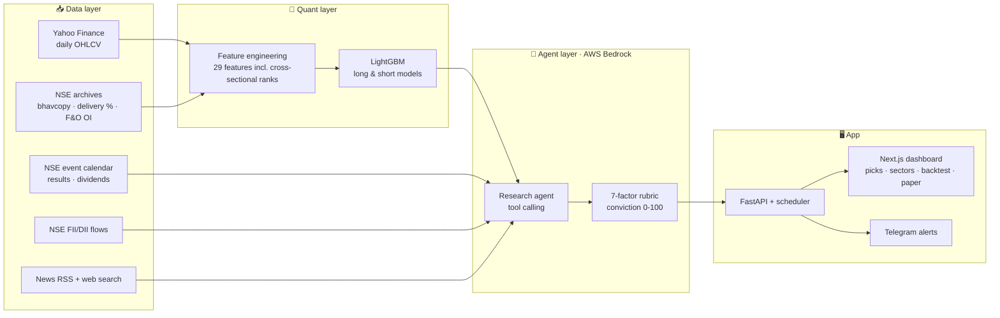

<div align="center">

# 📈 AI Swing Trader · NSE

**An end-to-end AI system that finds 15–20 day swing trades in Indian stocks (Nifty 50 / 100 / 500),
researches each one with LLM agents, and tracks every call against real market data.**


[Features](#-features) · [How it works](#-how-it-works) · [Results](#-backtest-results) · [Quick start](#-quick-start) · [Configuration](#%EF%B8%8F-configuration) · [API](#-api-reference) · [Limitations](#-limitations)

</div>

> [!WARNING]
> This project is for **education and research only**. It is not investment advice, and nothing here is a
> recommendation to buy or sell any security. Markets carry risk; past backtest results do not guarantee future returns.

---

## ✨ Features

| | Feature | What it does |
|---|---|---|
| 🧮 | **ML screener** | A LightGBM model ranks ~480 liquid NSE stocks every day by the probability that a swing trade hits its target before its stop within 20 sessions. Separate models for **long** and **short** setups. |
| 🤖 | **Research agents** | For the top candidates, LLM agents (AWS Bedrock) pull technicals, fundamentals, official NSE corporate events, news and web search, then score the trade on a fixed 7-factor rubric. |
| 🟢 | **Confidence tiers** | Final score = ML rank + agent conviction, adjusted for market regime and event risk. High-probability picks are highlighted in green. |
| 🔻 | **Short-sell ideas** | When the market is not bullish, F&O stocks are screened for short setups (with futures lot size), since multi-day shorts in India need stock futures. |
| 🧭 | **Market context** | Nifty regime (bullish / neutral / bearish), FII/DII net flows and a sector **money-flow heatmap**. |
| 📐 | **Position sizing** | Risk-based sizing from your capital and risk-per-trade: shares or lots, capital used, max loss and target profit for every pick. |
| 📝 | **Paper trading** | Open virtual trades from any pick. They auto-close at target, stop or the 20-day timeout, with live P&L. |
| 🔔 | **Telegram alerts** | New high-probability picks, target/stop hits on recommendations, and paper-trade exits. |
| 📊 | **Backtest dashboard** | Out-of-sample equity curve vs Nifty, drawdown chart, monthly returns and a feature-set comparison. |
| 💬 | **Research chat** | Ask about any stock or sector; the chat agent uses the same live tools and the latest scan. |
| ⏰ | **Automation** | Daily scan after market close, intraday target/stop checks every 15 minutes, monthly model retraining. |

---

## 🧠 How it works



### 1. The trade definition
Every signal is a **triple-barrier** trade sized by volatility (ATR):

| | Long | Short |
|---|---|---|
| Entry | Close of the signal day | Close of the signal day |
| Target | Entry **+ 3.5 × ATR** | Entry **− 3.5 × ATR** |
| Stop-loss | Entry **− 1.75 × ATR** | Entry **+ 1.75 × ATR** |
| Time limit | 20 trading days | 20 trading days |

That gives a 2:1 reward-to-risk ratio and an average holding time of ~10–11 sessions. The ML label is simply
*"did the target hit before the stop within 20 days?"*. When both are touched on the same day, the stop is assumed to hit first.

### 2. ML screener
- **Features:** RSI, MACD, ADX, ATR %, distance from EMA 20/50/200 and 52-week high/low, volume surge,
  Bollinger position, 5/20/60-day returns, relative strength vs Nifty, plus **cross-sectional ranks** and
  **sector momentum** across the whole universe each day.
- **Training:** pooled data from all Nifty 500 stocks (~450k rows), time-based split with an embargo so the test year
  never overlaps training labels. A last-12-months out-of-sample test decides which feature set is kept.
- **Experiments kept honest:** delivery %, futures OI change and options PCR were added as candidate features. They did
  **not** improve the out-of-sample backtest, so the model automatically kept the price/volume set; the NSE data
  is given to the agents as context instead.

### 3. Research agents
Each shortlisted stock gets its own agent run (4 in parallel). The agent is told the **setup type**
(trend continuation, pullback, mean-reversion bounce, overbought fade, …) and must score:

| Component | Max | Judges |
|---|---:|---|
| Setup structure | 20 | Structure that fits the setup type (not just "above EMAs") |
| Momentum | 15 | Relative strength, returns, RSI regime |
| Volume & flow | 15 | Volume surge, delivery %, futures OI buildup, sector flow |
| Fundamentals | 15 | Growth, margins, valuation, debt, analyst view |
| News & catalyst | 15 | Last 30 days of news and catalysts |
| Event risk | 10 | Official results / dividend dates inside the holding window |
| Risk–reward | 10 | Stop beyond logical support, room to target |

The code (not the LLM) sums the components into **conviction**: ≥ 65 → buy/short, 45–64 → watch, < 45 → avoid.
Confirmed red flags (fraud, regulatory action, pledge spikes, defaults) force *avoid*. Official NSE event dates override
the agent's own guess.

### 4. Final score and tiers
```
score = 0.55 × ML percentile + 0.45 × agent conviction
        − 8 when trading against the market regime
        + 4 for shorts in a bearish market
        − 4 when results fall inside the holding window
```
🟢 **High probability**: score ≥ 85 and the agent says buy/short · 🟩 **Good**: score ≥ 72 · ⚪ **Watch** · 🔴 **Avoid**

---

## 📊 Backtest results

Out-of-sample period **Oct 2025 → Sep 2026** (data the model never saw during training). Costs of 0.2% per round trip included.

<table>
<tr><th></th><th>Long model</th><th>Short model</th></tr>
<tr><td>Win rate, random stock (base rate)</td><td>21.7%</td><td>20.6%</td></tr>
<tr><td>Win rate, top ~1% ML signals</td><td><b>33.7%</b></td><td><b>35.1%</b></td></tr>
<tr><td>Avg return per signal (top ~1%)</td><td>+2.0%</td><td>+1.9%</td></tr>
<tr><td>Portfolio return (10 slots, top 2% signals)</td><td><b>+10.6%</b></td><td><b>+17.2%</b></td></tr>
<tr><td>Nifty 50, same period</td><td>−9.7%</td><td>−9.7%</td></tr>
<tr><td>Max drawdown</td><td>−16.3%</td><td>−8.0%</td></tr>
</table>

> [!NOTE]
> The ML edge is real but modest (AUC ≈ 0.53 long, 0.63 short), and a large part of the long-side return came from a single
> month. The agent layer is **not** included in this backtest; use paper trading and the built-in outcome tracking to judge it.

---

## 🖥️ Dashboard

| Tab | What you see |
|---|---|
| **AI Picks** | Buy ideas and short-sell ideas as cards, colored by tier, with entry / target / stop, position size, setup type and official event badges. Click a card for the candlestick chart, agent scorecard, bull/bear case, fundamentals, sources and the full research trail. |
| **Sector Heatmap** | Money flow (20D / 5D), 1D–3M returns, relative strength, breadth, turnover and delivery surge per sector. |
| **Backtest** | Equity curve vs Nifty, drawdown, monthly returns grid and feature-set comparison for both models. |
| **Paper Portfolio** | Virtual equity, realized / unrealized P&L, win rate and every open or closed trade. |

The research chat sits on the right (a floating button on mobile). Settings hold capital, risk %, F&O margin and Telegram.

---

## 🚀 Quick start

### Prerequisites
- Python **3.11+**, Node.js **20+**
- An AWS account with **Bedrock** access to a tool-calling model, and credentials configured locally (`aws configure`)

### 1. Backend
```bash
cd backend
python -m venv .venv
# Windows: .venv\Scripts\activate    macOS/Linux: source .venv/bin/activate
pip install -r requirements.txt
cp .env.example .env                 # then edit if needed

python -m app.data.nse 4             # one-time: 4 years of NSE delivery / F&O history (~30 min)
python -m app.model.train            # downloads prices, trains long + short models (~15 min)
uvicorn app.main:app --port 8000
```

### 2. Frontend
```bash
cd frontend
npm install
npm run dev                          # http://localhost:3000
```

### 3. First scan
Open the dashboard, choose **Nifty 50 / 100 / 500**, an optional sector, the research mode, and press **Run AI Scan**.
Agent progress streams live; a 20-stock scan takes about 5–8 minutes.

---

## ⚙️ Configuration

All settings live in `backend/.env` (see `.env.example`). AWS credentials are read from the standard AWS config, never from this repo.

| Variable | Default | Description |
|---|---|---|
| `AWS_REGION` | `us-east-1` | Bedrock region |
| `BEDROCK_MODEL_ID` | `moonshotai.kimi-k2.5` | Any Bedrock model that supports the Converse API with tool use |
| `HOLD_MIN_DAYS` / `HOLD_MAX_DAYS` | `15` / `20` | Swing holding window |
| `TARGET_ATR` / `STOP_ATR` | `3.5` / `1.75` | Barrier distances in ATR multiples |
| `AGENT_TOP_N` | `15` | Default number of stocks sent to the agents |

In-app **Settings** (stored in the local database): capital, risk per trade %, F&O margin %, Telegram bot token and chat ID, alerts on/off.

### Telegram alerts
1. Open **@BotFather** in Telegram → `/newbot` → copy the bot token.
2. Send `/start` to your new bot.
3. Paste the token in **Settings** and save (the chat ID is detected automatically), then press **Send test alert**.

> WhatsApp needs a paid Business API, so alerts use Telegram's free Bot API.

---

## ⏰ Automation

| Job | When (IST) | What it does |
|---|---|---|
| Daily scan | Mon–Fri 18:30 | Refresh NSE data and FII/DII, update outcomes and paper trades, run a Nifty 500 scan with research |
| Intraday check | Mon–Fri 09:00–15:45, every 15 min | Check paper trades and open green picks against live prices; send target/stop alerts |
| Retrain | 1st Saturday of each month, 10:00 | Retrain both models on fresh data and re-run the feature-set comparison |

The backend must stay running for these jobs (see [Deployment](#-deployment)).

---

## 🔌 API reference

| Method | Endpoint | Description |
|---|---|---|
| `POST` | `/api/scan` | Start a scan: `{universe, sector, mode: "news" \| "technical", top_n}` |
| `GET` | `/api/scans/{id}` · `/api/scans/latest` | Scan status, live progress log and picks |
| `GET` | `/api/stock/{symbol}` | Candles, technicals and fundamentals |
| `GET` | `/api/market` | Nifty regime and FII/DII flows |
| `GET` | `/api/sectors?index=NIFTY500` | Sector heatmap data |
| `GET` | `/api/backtest` | Portfolio backtest, monthly returns, feature comparison |
| `GET` | `/api/model?side=long\|short` | Model report |
| `GET` `POST` `DELETE` | `/api/paper` · `/api/paper/{id}/close` · `/api/paper/{id}` | Paper trading |
| `GET` `PUT` | `/api/settings` | Capital, risk, alerts (bot token is never returned) |
| `POST` | `/api/alerts/test` | Send a Telegram test message |
| `POST` | `/api/chat` | Research chat (server-sent events) |
| `GET` | `/api/performance` | Live hit rate of past recommendations by tier |

Interactive docs are available at `http://localhost:8000/docs`.

---

## 🗂️ Project structure

```
backend/
  app/
    main.py              FastAPI routes + scheduler jobs
    config.py            Environment settings
    universe.py          Nifty 50/100/500 lists, sector tags, F&O lot sizes
    features.py          Indicators, NSE features, triple-barrier labels
    sectors.py           Sector heatmap metrics
    paper.py             Paper trading engine
    alerts.py            Telegram alerts
    chat.py              Research chat agent
    db.py                SQLite storage
    data/
      prices.py          Yahoo prices with NSE bhavcopy fallback
      nse.py             NSE archives: delivery, F&O OI, bhavcopy, FII/DII
      events.py          NSE corporate event calendar
      live.py            Intraday quotes
    model/train.py       Training, feature-set comparison, portfolio backtest
    agents/
      llm.py             Bedrock Converse tool-calling loop
      tools.py           Agent tools (technicals, fundamentals, events, news, web)
      research_agent.py  Rubric-based research agent
      orchestrator.py    Scan pipeline, scoring, outcome tracking
  tests/                 Look-ahead, label and paper-trading tests
frontend/
  app/page.tsx           Dashboard
  components/            Pick cards, stock drawer, heatmap, backtest, paper, chat, settings
  lib/                   API client and position sizing
```

---

## 🧾 Data sources

| Source | Used for |
|---|---|
| Yahoo Finance (`yfinance`) | Daily and intraday prices, fundamentals |
| NSE archives | Index constituents, equity bhavcopy (OHLC fallback, delivery %), F&O bhavcopy (OI, PCR), index closes |
| NSE APIs | Corporate event calendar, FII/DII cash flows |
| Google News RSS, DuckDuckGo | News and web research for the agents |
| AWS Bedrock | LLM for research agents and chat |

Yahoo data is ~15 minutes delayed intraday. When Yahoo misses the latest daily bar, it is filled from the official NSE bhavcopy.

---

## ☁️ Deployment

The backend needs to run continuously for scans, alerts and retraining. Free options:

| Option | Notes |
|---|---|
| **Oracle Cloud Always Free** (Mumbai / Hyderabad) | Best fit: an always-free ARM VM with plenty of RAM and an Indian IP, which NSE endpoints prefer |
| Home machine + **Cloudflare Tunnel** | Free, NSE-friendly residential IP; the machine must stay on |
| **Vercel** | Free hosting for the Next.js frontend |

Bedrock usage is billed by AWS in every option. Add authentication before exposing the dashboard publicly.

---

## 🧪 Testing

```bash
cd backend && pytest
```
Tests cover the absence of look-ahead in technical and NSE features, the triple-barrier labels and the paper-trade barrier logic.

---

## ⚠️ Limitations

- The statistical edge is modest; expect many losing trades even when the system works as designed.
- The agent layer is evaluated only going forward (outcome tracking + paper trading), not in the historical backtest.
- Free data feeds can lag, change format or rate-limit. NSE may block cloud/datacenter IPs.
- Short selling via futures has unlimited loss potential and margin requirements; sizing uses an approximate margin %.
- Survivorship bias: the universe is today's index membership.

## 🛣️ Roadmap

- [ ] Login and one-click cloud deployment (Docker)
- [ ] Calibrate agent thresholds from live outcomes
- [ ] Broker API integration for real-time prices
- [ ] Walk-forward retraining report in the dashboard

---

<div align="center">
<sub>Built for learning how quantitative screening and LLM research agents can work together. Not financial advice.</sub>
</div>
