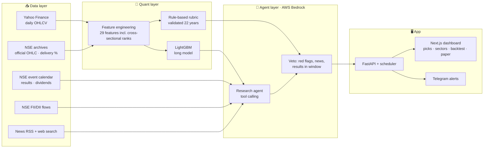

<div align="center">

# 📈 AI Swing Trader · NSE

**An end-to-end AI system that finds 15–20 day swing trades in Indian stocks (Nifty 50 / 100 / 500),
researches each one with LLM agents, and tracks every call against real market data.**


[](https://github.com/musaddiq-vd/stock-recommendation-system/actions/workflows/ci.yml)


[Features](#-features) · [How it works](#-how-it-works) · [Results](#-backtest-results) · [Quick start](#-quick-start) · [Configuration](#%EF%B8%8F-configuration) · [API](#-api-reference) · [Limitations](#-limitations)

</div>

> [!WARNING]
> This project is for **education and research only**. It is not investment advice, and nothing here is a
> recommendation to buy or sell any security. Markets carry risk; past backtest results do not guarantee future returns.

---

## ✨ Features

| | Feature | What it does |
|---|---|---|
| 🧮 | **ML screener** | A LightGBM model ranks ~480 liquid NSE stocks every day by the probability that a long swing trade hits its target before its stop within 20 sessions. |
| 📏 | **Rule-based rubric** | Setup structure, momentum, volume and risk-reward scored on fixed rules that were validated on 22 years of data. |
| 🤖 | **Research agent** | For the top candidates, an LLM agent (AWS Bedrock) reads news, filings, fundamentals and official NSE event dates, and can veto a pick for red flags, negative news or results inside the holding window. |
| 🟢 | **Confidence tiers** | Final score = ML rank + a rule-based rubric, both validated on 22 years of walk-forward data. Green requires every gate: market regime, rubric and an AI agent veto check. |
| 🧭 | **Market context** | Nifty regime (bullish / neutral / bearish), FII/DII net flows and a sector **money-flow heatmap**. |
| 📐 | **Position sizing** | Risk-based sizing from your capital and risk-per-trade: shares or lots, capital used, max loss and target profit for every pick. |
| 📝 | **Paper trading** | Open virtual trades from any pick. They auto-close at target, stop or the 20-day timeout, with live P&L. |
| 🔔 | **Telegram alerts** | New high-probability picks, target/stop hits on recommendations, and paper-trade exits. |
| 🔬 | **22-year research** | Walk-forward test from 2004 to 2026 on 30 years of data: 20 target/stop settings, regime and rubric filters, a random baseline and an anonymised LLM test. |
| 📈 | **Live track record** | Real outcomes of the app's own past picks (target, stop or 20-day exit), per tier. |
| 📊 | **Backtest dashboard** | Out-of-sample equity curve vs Nifty, drawdown chart, monthly returns and a feature-set comparison. |
| 💬 | **Research chat** | Ask about any stock or sector; the chat agent uses the same live tools and the latest scan. |
| ⏰ | **Automation** | Daily scan after market close, intraday target/stop checks every 15 minutes, monthly model retraining. |

---

## 🧠 How it works



### 1. The trade definition
Every signal is a long **triple-barrier** trade sized by volatility (ATR):

| | Long |
|---|---|
| Entry | Close of the signal day |
| Target | Entry **+ 3.5 × ATR** |
| Stop-loss | Entry **− 2.5 × ATR** |
| Time limit | 20 trading days |

This 1.4 : 1 reward-to-risk setting was chosen by the 22-year research below: it kept win rate above 50% with the best
profit factor while holding trades for ~13 sessions on average (a third run the full 20 days). The ML label is simply
*"did the target hit before the stop within 20 days?"*. When both are touched on the same day, the stop is assumed to hit first.

### 2. ML screener
- **Features:** RSI, MACD, ADX, ATR %, distance from EMA 20/50/200 and 52-week high/low, volume surge,
  Bollinger position, 5/20/60-day returns, relative strength vs Nifty, plus **cross-sectional ranks** and
  **sector momentum** across the whole universe each day.
- **Training:** pooled data from all Nifty 500 stocks (~450k rows), time-based split with an embargo so the test year
  never overlaps training labels; the last 12 months are held out as an out-of-sample check.
- **What was tried and dropped:** delivery %, futures OI change and options PCR did **not** improve the out-of-sample
  backtest, and short setups lost money in every tested setting, so neither is part of the live app.

### 3. Rule-based rubric
Four components, computed from price and volume data with fixed rules, so they can be (and were) backtested over 22 years:

| Component | Max | Judges |
|---|---:|---|
| Setup structure | 20 | Structure that fits the setup type (trend, pullback, oversold bounce), not just "above EMAs" |
| Momentum | 15 | Cross-sectional rank of relative strength and 20-day return |
| Volume | 15 | Volume surge and up-day participation |
| Risk–reward | 10 | Stop sits below the 20-day swing low |

The total is rescaled to 0–100; a score of **70 or more** is one of the gates for the top tier.

### 4. Research agent (veto only)
200 past signals were shown to the LLM with the name, sector and dates hidden and prices rebased to 100. Its chart
reading did **not** separate winners from losers (AUC 0.48), so the agent never adds to the score. Its job is the part a
price model cannot see: news, filings and event dates. It holds a pick back when it finds a confirmed serious red flag
(fraud, trading ban, default, large asset seizure; small procedural fines do not count), clearly negative news, or
results inside the holding window. Official NSE event dates always override its own guess, and it runs at temperature 0
so the same facts give the same verdict.

### 5. Final score and tiers
```
score = 0.6 × ML percentile + 0.4 × rule-based rubric
        − 8 when trading against the market regime
        − 4 when results fall inside the holding window
```
| Tier | Rule | Backed by (22-year walk-forward) |
|---|---|---|
| 🟢 **Top tier** | score ≥ 85, Nifty above its 200-day average, rubric ≥ 70, agent clear | 54.8% profitable, profit factor 1.61, worst drawdown −18% |
| 🟩 **Good** | score ≥ 72, Nifty above its 200-day average, agent clear | 53.8% profitable, profit factor 1.52, worst drawdown −31% |
| ⚪ **Watch** | everything else | – |
| 🔴 **Avoid** | confirmed red flag | – |

Every card shows the numbers behind its tier, so a label never promises more than history delivered.

---

## 📊 Backtest results

### 22-year walk-forward (2004 → 2026)
Prices from 1996 for 475 stocks. Every year is traded by a model trained only on earlier years, with a 10-slot portfolio and
0.2% cost per trade. Filter thresholds were chosen on data before 2016; 2016–2026 is the out-of-sample check.

| Strategy (long, target 3.5 / stop 2.5 ATR) | Trades | Win rate | Profit factor | Avg trade | Max drawdown | Win rate 2016+ |
|---|---:|---:|---:|---:|---:|---:|
| Random pick, same universe | 3,774 | 51.3% | 1.29 | +1.1% | −77% | 50.9% |
| ML top 2% | 4,253 | 54.2% | 1.53 | +1.7% | −64% | 54.0% |
| **ML + regime + rubric (live setting)** | **1,620** | **54.8%** | **1.61** | **+1.7%** | **−18%** | **53.0%** |

Other findings:
- **Win rate vs. profit:** smaller targets push win rate to 62–76%, but the profit factor drops and trades last only 6–9 days.
  The live setting is the best balance of win rate above 50%, profit factor and a 15–20 day holding window.
- **Market regime filter** (long only when Nifty is above its 200-day average) cut the worst drawdown from −64% to −18%.
- **Short setups** lost money in all 20 target/stop settings over 22 years (profit factor 0.73–0.84), with or without
  filters, which is why the live app is long-only.

Reproduce with:
```bash
python -m app.research.history                 # download max price history (~5 min)
python -m app.research.experiment build        # features + outcomes for 20 settings x 2 sides
python -m app.research.experiment walk         # yearly walk-forward models
python -m app.research.analyze long            # baseline vs filters, tuned before 2016, checked after
python -m app.research.analyze export          # results shown in the Backtest tab
python -m app.research.llm_backtest long 3.5 2.5   # anonymised LLM test (~200 Bedrock calls)
```

### Latest model, last 12 months
Out-of-sample period **Oct 2025 → Sep 2026** with the live long setting (target 3.5 / stop 2.5 ATR), model trained on the
previous five years. Costs of 0.2% per round trip included.

| Long model | Value |
|---|---:|
| Target-hit rate, random stock | 23.8% |
| Target-hit rate, top ~1% ML signals | **33.6%** |
| Portfolio return (10 slots, top 2% signals) | **+14.3%** |
| Nifty 50, same period | −9.7% |
| Profitable trades after costs | 47.8% |
| Max drawdown | −12.7% |

**Win rate** in this README means trades that closed in profit after costs (at the target, or above entry at the 20-day exit).
**Target-hit rate** counts only trades that reached the full target before the stop.

> [!NOTE]
> Every row above uses today's Nifty 500 list, so stocks that were delisted are missing (survivorship bias). That flatters
> absolute returns for every strategy, including the random baseline; compare strategies against each other.

---

## 🖥️ Dashboard

| Tab | What you see |
|---|---|
| **AI Picks** | Buy ideas as cards, colored by tier, with the 22-year stats of that tier, entry / target / stop, position size, gates and official event badges. Click a card for the candlestick chart, rubric breakdown, gates, the agent's news findings, fundamentals, sources and the full research trail. |
| **Sector Heatmap** | Money flow (20D / 5D), 1D–3M returns, relative strength, breadth, turnover and delivery surge per sector. |
| **Backtest** | Live track record of past picks, the 22-year walk-forward (equity, yearly returns, per-tier stats) and the latest model's 12-month test. |
| **Paper Portfolio** | Virtual equity, realized / unrealized P&L, win rate and every open or closed trade. |

The research chat sits on the right (a floating button on mobile). Settings hold capital, risk % and Telegram.

---

## 🚀 Quick start

### Prerequisites
- Python **3.11+**, Node.js **20+**
- An AWS account with **Bedrock** access to a tool-calling model, and credentials configured locally (`aws configure`)

### 1. Backend
```bash
cd backend
python -m venv .venv
# Windows: .venv\Scripts\activate    macOS/Linux: source .venv/bin/activate
pip install -r requirements-dev.txt  # runtime + test/lint tools
cp .env.example .env                 # then edit if needed

python -m app.data.nse              # one-time: ~4 months of NSE delivery data for the heatmap (~3 min)
python -m app.model.train            # downloads prices, trains the model (~10 min)
uvicorn app.main:app --port 8000
```

### 2. Frontend
```bash
cd frontend
npm install
npm run dev                          # http://localhost:3000
```

### 3. First scan
Open the dashboard, choose **Nifty 50 / 100 / 500**, an optional sector and how many stocks to research, then press **Run AI Scan**.
Agent progress streams live; a 20-stock scan takes about 5–8 minutes.

---

## ⚙️ Configuration

All settings live in `backend/.env` (see `.env.example`). AWS credentials come from the standard AWS config or
environment variables, never from this repo.

| Variable | Default | Description |
|---|---|---|
| `APP_PASSWORD` | *(empty)* | Dashboard password. **Required in production**; empty disables login (local development only) |
| `APP_SECRET` | *(random)* | Signs login tokens. Set a long random value so sessions survive restarts |
| `TOKEN_TTL_HOURS` | `168` | How long a login stays valid |
| `ALLOWED_ORIGINS` | `http://localhost:3000` | Comma-separated dashboard URLs allowed to call the API (CORS) |
| `RUN_SCHEDULER` | `1` | Run the scheduled jobs in this API process; keep exactly one such process |
| `STORAGE_DIR` | `backend/storage` | Where prices, models and the SQLite database live |
| `LOG_LEVEL` | `INFO` | Python logging level |
| `AWS_REGION` | `us-east-1` | Bedrock region |
| `BEDROCK_MODEL_ID` | `moonshotai.kimi-k2.5` | Any Bedrock model that supports the Converse API with tool use |
| `HOLD_MIN_DAYS` / `HOLD_MAX_DAYS` | `15` / `20` | Swing holding window |
| `TARGET_ATR` / `STOP_ATR` | `3.5` / `2.5` | Barrier distances in ATR multiples |
| `REGIME_FILTER` | `1` | Long picks can be green only when Nifty is above its 200-day average |
| `RUBRIC_MIN` | `70` | Rule-based rubric score required for green |
| `AGENT_TOP_N` | `15` | Default number of stocks sent to the agents |

In-app **Settings** (stored in the local database): capital, risk per trade %, Telegram bot token and chat ID, alerts on/off.

### Telegram alerts
1. Open **@BotFather** in Telegram → `/newbot` → copy the bot token.
2. Send `/start` to your new bot.
3. Paste the token in **Settings** and save (the chat ID is detected automatically), then press **Send test alert**.

> WhatsApp needs a paid Business API, so alerts use Telegram's free Bot API.

---

## ⏰ Automation

| Job | When (IST) | What it does |
|---|---|---|
| Daily scan | Mon–Fri 18:30 | Refresh NSE data and FII/DII, update outcomes and paper trades, run a Nifty 500 scan with research |
| Intraday check | Mon–Fri 09:00–15:45, every 15 min | Check paper trades and open green picks against live prices; send target/stop alerts |
| Retrain | 1st Saturday of each month, 10:00 | Retrain both models on fresh data and re-run the feature-set comparison |

The backend must stay running for these jobs (see [Deployment](#-deployment)).

---

## 🔌 API reference

| Method | Endpoint | Description |
|---|---|---|
| `POST` | `/api/scan` | Start a scan: `{universe, sector, top_n}` (409 while another scan runs) |
| `GET` | `/api/scans/{id}` · `/api/scans/latest` | Scan status, live progress log and picks |
| `GET` | `/api/stock/{symbol}` | Candles, technicals and fundamentals |
| `GET` | `/api/market` | Nifty regime and FII/DII flows |
| `GET` | `/api/sectors?index=NIFTY500` | Sector heatmap data |
| `GET` | `/api/backtest` | Portfolio backtest, monthly returns, feature comparison |
| `GET` | `/api/model` | Model report |
| `GET` `POST` `DELETE` | `/api/paper` · `/api/paper/{id}/close` · `/api/paper/{id}` | Paper trading |
| `GET` `PUT` | `/api/settings` | Capital, risk, alerts (bot token is never returned) |
| `POST` | `/api/alerts/test` | Send a Telegram test message |
| `POST` | `/api/chat` | Research chat (server-sent events) |
| `GET` | `/api/performance` | Live track record of past recommendations by tier |

Interactive docs are available at `http://localhost:8000/docs`.

---

## 🗂️ Project structure

```
backend/
  app/
    main.py              FastAPI routes, login middleware, scheduler jobs
    auth.py              Password login, signed tokens, rate limit
    config.py            Environment settings
    universe.py          Nifty 50/100/500 lists and sector tags
    features.py          Indicators, NSE features, triple-barrier labels
    sectors.py           Sector heatmap metrics
    paper.py             Paper trading engine
    alerts.py            Telegram alerts
    chat.py              Research chat agent
    db.py                SQLite storage
    data/
      prices.py          Yahoo prices with NSE bhavcopy fallback
      nse.py             NSE archives: official OHLC, delivery, FII/DII
      events.py          NSE corporate event calendar
      live.py            Intraday quotes
    model/train.py       Training, feature-set comparison, portfolio backtest
    agents/
      llm.py             Bedrock Converse tool-calling loop
      tools.py           Agent tools (technicals, fundamentals, events, news, web)
      research_agent.py  Rubric-based research agent
      orchestrator.py    Scan pipeline, scoring, outcome tracking
  tests/                 Look-ahead, label and paper-trading tests
frontend/
  app/page.tsx           Dashboard
  components/            Pick cards, stock drawer, heatmap, backtest, paper, chat, settings
  lib/                   API client and position sizing
```

---

## 🧾 Data sources

| Source | Used for |
|---|---|
| Yahoo Finance (`yfinance`) | Daily and intraday prices, fundamentals |
| NSE archives | Index constituents, equity bhavcopy (OHLC fallback, delivery %), index closes |
| NSE APIs | Corporate event calendar, FII/DII cash flows |
| Google News RSS, DuckDuckGo | News and web research for the agents |
| AWS Bedrock | LLM for research agents and chat |

Yahoo data is ~15 minutes delayed intraday. When Yahoo misses the latest daily bar, it is filled from the official NSE bhavcopy.

---

## ☁️ Deployment

### Docker (recommended)
```bash
cp backend/.env.example backend/.env
# set APP_PASSWORD, APP_SECRET and AWS_ACCESS_KEY_ID / AWS_SECRET_ACCESS_KEY (or use an instance role)
docker compose up -d --build
```
- `api` on port 8000: FastAPI + scheduler, data in the `swing-data` volume, health check on `/api/health`.
- `web` on port 3000: the Next.js dashboard as a standalone Node server.
- For a public domain, set `PUBLIC_API_URL` (baked into the dashboard at build time) and `PUBLIC_WEB_URL`
  (allowed CORS origin) before `docker compose build`, and put both behind HTTPS (Caddy, Nginx or Cloudflare).
- After the first start, train the models once inside the container:
  `docker compose exec api python -m app.model.train`

### Production checklist
- [x] Password login with signed, expiring tokens and a rate limit on failed attempts
- [x] CORS limited to your dashboard URL; errors never return stack traces
- [x] Input validation on every endpoint (symbols, scans, chat, settings, paper trades)
- [x] One scan at a time; scans interrupted by a restart are closed automatically
- [x] Non-root containers, health checks, pinned Python dependencies, CI on every push
- [ ] Serve over HTTPS and keep `APP_PASSWORD` / `APP_SECRET` / AWS keys only in the server's `.env`
- [ ] Back up the `swing-data` volume (SQLite database, models and paper trades)

### Hosting options
The backend needs to run continuously for scans, alerts and retraining. Free options:

| Option | Notes |
|---|---|
| **Oracle Cloud Always Free** (Mumbai / Hyderabad) | Best fit: an always-free ARM VM with plenty of RAM and an Indian IP, which NSE endpoints prefer |
| Home machine + **Cloudflare Tunnel** | Free, NSE-friendly residential IP; the machine must stay on |
| **Vercel** | Free hosting for the Next.js frontend |

Bedrock usage is billed by AWS in every option. Always set `APP_PASSWORD` before exposing the dashboard.

---

## 🧪 Testing

```bash
cd backend && ruff check app tests && pytest     # lint + tests
cd frontend && npm run lint && npx tsc --noEmit  # lint + type check
```
Tests cover the absence of look-ahead in the features, the vectorised triple-barrier labels, pick outcome tracking, paper-trade
logic (including opening at the current price), login and token expiry, rate limiting, input validation, the one-scan
lock, recovery after restart and the tier rules. GitHub Actions runs all of it plus both Docker builds on every push.

---

## ⚠️ Limitations

- The statistical edge is modest; expect many losing trades even when the system works as designed.
- The agent layer is evaluated only going forward (outcome tracking + paper trading), not in the historical backtest.
- Free data feeds can lag, change format or rate-limit. NSE may block cloud/datacenter IPs.
- Survivorship bias: the universe is today's index membership.
- The LLM's news and fundamentals judgement cannot be backtested (no as-of-date news archive); only its chart reading was
  tested, and it showed no edge. Treat the agent as a risk filter, not a source of alpha.

## 🛣️ Roadmap

- [x] Login, Docker deployment and CI
- [ ] Calibrate agent thresholds from live outcomes
- [ ] Broker API integration for real-time prices
- [ ] Walk-forward retraining report in the dashboard

---

<div align="center">
<sub>Built for learning how quantitative screening and LLM research agents can work together. Not financial advice.</sub>
</div>
